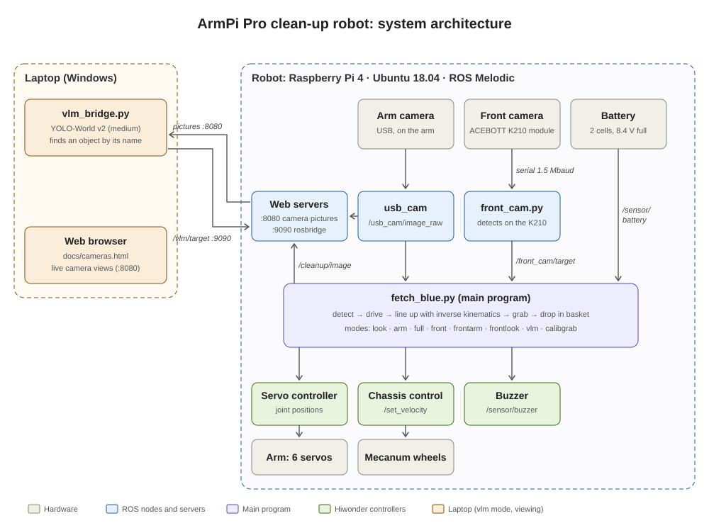

# ArmPi Pro clean-up robot

A Hiwonder ArmPi Pro that cleans up on its own: it finds blue and red cubes, drives to them, picks them up with its arm and drops them in the basket on its back. A front camera (ACEBOTT K210 AI vision module) finds the cube, and the arm camera lines up the grab using inverse kinematics. Optionally, a YOLO-World AI model on a laptop finds objects by name.



## Documentation

All documentation is in the [`docs`](docs/README.md) folder:

- [Architecture](docs/architecture.md): the parts of the system, ROS topics and ports
- [How it works](docs/how-it-works.md): the workflow step by step, and why YOLO-World is used
- [Setup and running](docs/setup-and-running.md): connecting, teaching poses, every mode, start and stop
- [Troubleshooting](docs/troubleshooting.md): arm shaking, battery, cameras, network, git
- [Project log](docs/project-log.md): what was built, day by day, and the current status
- [FAQ](docs/faq.md): common questions with short answers

## Quick start

On the robot (after `ssh ubuntu@ROBOT_ADDRESS` and `source ~/armpi_pro/devel/setup.bash`):

```bash
python3 ~/fetch_blue.py look     # detection test: nothing moves
python3 ~/fetch_blue.py arm      # arm only: grab a cube placed in front
bash ~/run_robot.sh              # front camera + driving, runs in the background
bash ~/stop_robot.sh             # stop everything and the wheels
```

Before the first run, teach the LOOK and DROP poses with `python3 ~/cleanup.py teach`. Charge the battery to at least 7.5 V before driving. See [Setup and running](docs/setup-and-running.md) for the details.

## Files

| Path | Purpose |
|---|---|
| `robot/fetch_blue.py` | **Main program.** Detection, driving, inverse-kinematics line-up, grab, drop in the basket, retry. Modes: `look`, `arm`, `full`, `front`, `frontarm`, `frontlook`, `vlm`, `calibgrab` |
| `robot/front_cam.py` | Front camera: runs a detection program on the K210 module, publishes `/front_cam/image` and `/front_cam/target` |
| `robot/run_robot.sh`, `robot/stop_robot.sh` | Start the front camera and `fetch_blue.py` in the background (survives an SSH drop); stop everything and zero the wheels |
| `robot/cleanup.py` | Teach mode for the arm poses, plus older test modes (`pick`, `calib`, `fetch`, `run`) |
| `robot/teleop_keys.py` | Keyboard control of wheels, arm and gripper |
| `robot/detect_objects.py` | Colour detection only, no movement; for tuning colour ranges |
| `robot/wander.py` | Drives around on its own for a set time (no obstacle sensor) |
| `robot/wifi.yaml.example` | Template for the robot's Wi-Fi settings (`/etc/Hiwonder/wifi.yaml`) |
| `vlm/vlm_bridge.py` | Laptop: finds the named object with YOLO-World, sends its position to the robot on `/vlm/target` |
| `vlm/benchmark.py`, `vlm/phase2_test.py` | Laptop: model speed test and robot connection test |
| `install_deps.bat` | Laptop: installs the YOLO-World software into `vlm/.venv` |
| `open_docs.bat` | Opens the plan page and the camera page in the browser |
| `docs/` | Documentation, diagrams and interactive pages |

Taught poses are saved on the robot in `~/cleanup_poses.json` and `~/arm_home.json`; they are not in this repository.

## Status (19 November 2026)

Colour detection is stable, the arm-only grab works (not every time yet), and the front camera finds cubes. Driving has been limited by low battery. The laptop side of YOLO-World works; the robot grab with it is written and simulated but not yet tested on the robot. See the [project log](docs/project-log.md).
