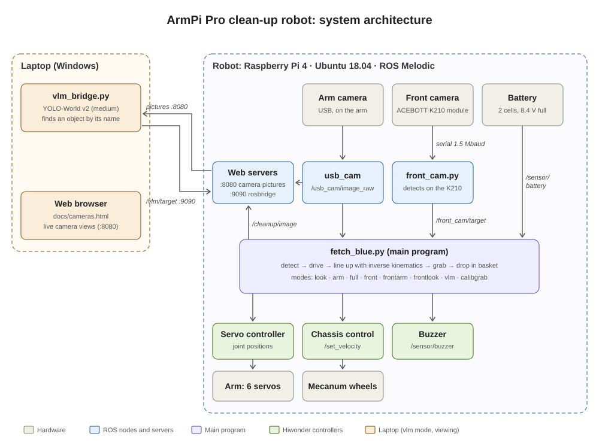

# Documentation

Everything about the ArmPi Pro clean-up robot: what it is, how it works, how to run it, and what was done.

## Pages

| Page | What it covers |
|---|---|
| [Architecture](architecture.md) | The parts of the system (robot, cameras, laptop), how they connect, ROS topics and ports |
| [How it works](how-it-works.md) | The clean-up workflow step by step: detection, driving, lining up, grabbing, dropping, safety, and why YOLO-World is used |
| [Setup and running](setup-and-running.md) | Network, logging in, copying scripts, every mode, teaching poses, laptop vision, start and stop, saving to GitHub |
| [Troubleshooting](troubleshooting.md) | Common problems: arm shaking, low battery, camera not found, laptop not connecting, git errors |
| [Project log](project-log.md) | What was built, day by day, and the current status |
| [FAQ](faq.md) | Questions people ask about the project, with short answers |
| [Laptop vision plan](vlm-plan.md) | The YOLO-World plan with test results for each phase |

## Interactive pages

Open these in a browser (or double-click `open_docs.bat` in the repository folder):

- [cleanup-robot-plan.html](cleanup-robot-plan.html): development plan with an animated simulation
- [cleanup-robot-simulation.html](cleanup-robot-simulation.html): step-by-step animation of the clean-up logic
- [cameras.html](cameras.html): both robot cameras side by side (the laptop must be on the robot's network)

## Diagrams

- [images/architecture.svg](images/architecture.svg): system architecture
- [images/workflow.svg](images/workflow.svg): the clean-up workflow
