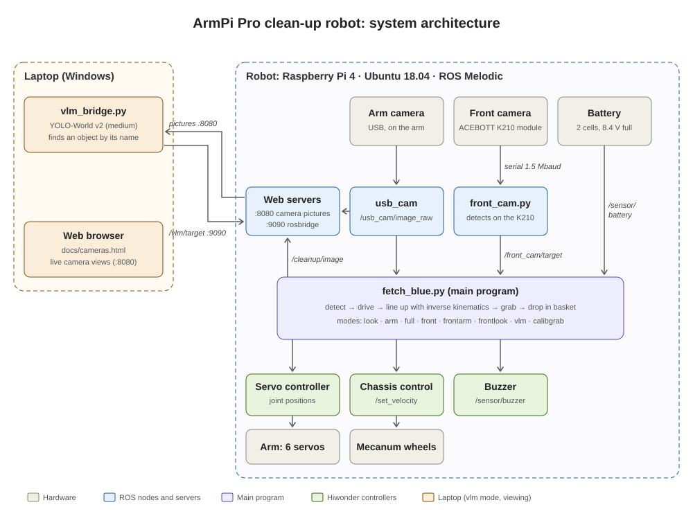

# Architecture

The system has two computers. The **robot** (a Raspberry Pi 4 inside the Hiwonder ArmPi Pro) does everything needed to clean up on its own. The **laptop** is optional: it is used to watch the cameras and, in `vlm` mode, to run the YOLO-World AI model that the Pi is too slow for.

All programs on the robot talk to each other through **ROS** (Robot Operating System, version Melodic). A program publishes messages on a named *topic*, and any other program can subscribe to that topic.

## Hardware

| Part | Details |
|---|---|
| Computer | Raspberry Pi 4, Ubuntu 18.04, ROS Melodic, workspace `~/armpi_pro` |
| Arm | 6 bus servos: 1 gripper, 2 wrist rotate, 3 wrist, 4 elbow, 5 shoulder, 6 base. On this robot a low gripper value is open (about 120) and a high value is closed (about 450) |
| Base | 4 mecanum wheels: forward, sideways and turning on the spot |
| Arm camera | USB colour camera on the arm, looking down at the gripper. Used to line up and grab |
| Front camera | ACEBOTT K210 AI vision module (Kendryte K210, GC2145 sensor) on `/dev/ttyUSB0`, 1.5 Mbaud serial. It finds coloured patches on its own chip at about 5–7 pictures per second. Used to find the cube from further away |
| Battery | 2-cell pack, about 8.4 V when full. Driving needs at least 7.5 V; below about 6 V the pack can be damaged |
| Other | Buzzer, RGB LEDs. No lidar, depth or distance sensor |
| Basket | On the robot's back. The arm turns round and drops the cube in |

## Software parts

| Part | Runs on | What it does |
|---|---|---|
| `robot/fetch_blue.py` | Robot | **Main program.** Finds blue and red cubes, drives to them, lines up the gripper with inverse kinematics, grabs, drops in the basket, repeats |
| `robot/front_cam.py` | Robot | Sends a small detection program to the K210 front camera, then publishes its picture and the cube position as ROS topics |
| `robot/run_robot.sh` / `stop_robot.sh` | Robot | Start the front camera and the main program in the background (they survive an SSH drop); stop everything and zero the wheels |
| `robot/cleanup.py` | Robot | Teach mode for the arm poses (LOOK, DROP and others), plus older test modes |
| `robot/teleop_keys.py` | Robot | Drive the wheels and move the arm with the keyboard |
| `robot/detect_objects.py` | Robot | Colour detection only, nothing moves; for tuning colour ranges |
| `robot/wander.py` | Robot | Drives around on its own for a set time (no obstacle sensor) |
| `vlm/vlm_bridge.py` | Laptop | Downloads arm-camera pictures, finds the named object with YOLO-World, sends its position back to the robot |
| `vlm/benchmark.py`, `vlm/phase2_test.py` | Laptop | Speed test of the model; connection test to the robot |
| Hiwonder services | Robot | Come with the robot: `usb_cam`, servo controller, chassis control, `web_video_server` (port 8080), `rosbridge` (port 9090) |

## ROS topics and ports

| Topic or port | From → to | Contents |
|---|---|---|
| `/usb_cam/image_raw` | usb_cam → fetch_blue.py, web server | Arm camera pictures |
| `/front_cam/image` | front_cam.py → web server | Front camera pictures (only while `front_cam.py` runs) |
| `/front_cam/target` | front_cam.py → fetch_blue.py | JSON: found, centre (cx, cy), size, picture size |
| `/cleanup/image` | fetch_blue.py → web server | Arm camera with boxes and status text drawn on top |
| `/vlm/target` | laptop vlm_bridge.py → fetch_blue.py | JSON: label, found, confidence, box, centre |
| `/servo_controllers/port_id_1/multi_id_pos_dur` | fetch_blue.py → servo controller | Arm joint positions and move time |
| `/chassis_control/set_velocity` | fetch_blue.py → chassis control | Wheel speed, direction and turn rate |
| `/sensor/battery` | robot → fetch_blue.py | Battery voltage in millivolts |
| `/sensor/buzzer` | fetch_blue.py → buzzer | Beep length |
| Port **8080** | robot → laptop browser / vlm_bridge.py | `web_video_server`: camera pictures over HTTP |
| Port **9090** | laptop ↔ robot | `rosbridge`: lets the laptop publish ROS topics over a websocket |

View any camera topic in a browser: `http://ROBOT_ADDRESS:8080/stream_viewer?topic=TOPIC`.

## Why it is split this way

- **Front camera finds, arm camera grabs.** The front camera sees the floor ahead, so it is best for finding and driving. The arm camera looks straight down at the gripper, so it is best for exact lining up.
- **Detection on the K210 chip.** The front camera module finds the coloured patch itself, so the Pi does not have to process those pictures.
- **YOLO-World on the laptop.** The Pi 4 is too slow for it; the laptop's processor is about 10 times faster. The laptop only reports *where* the object is. The robot still moves the arm itself, so a slow or dropped network cannot make the arm do something wild.
- **Nothing extra installed on the robot for laptop vision.** The camera web server and rosbridge already come with the Hiwonder image.

## Saved settings on the robot (not in this repository)

| File | Contents |
|---|---|
| `~/cleanup_poses.json` | Taught arm poses (LOOK, DROP, …) and the calibrated grab point `grab_centre` |
| `~/arm_home.json` | Home pose from `teleop_keys.py` |
| `~/fetch_log.txt`, `~/front_cam.log` | Logs written by `run_robot.sh` |
