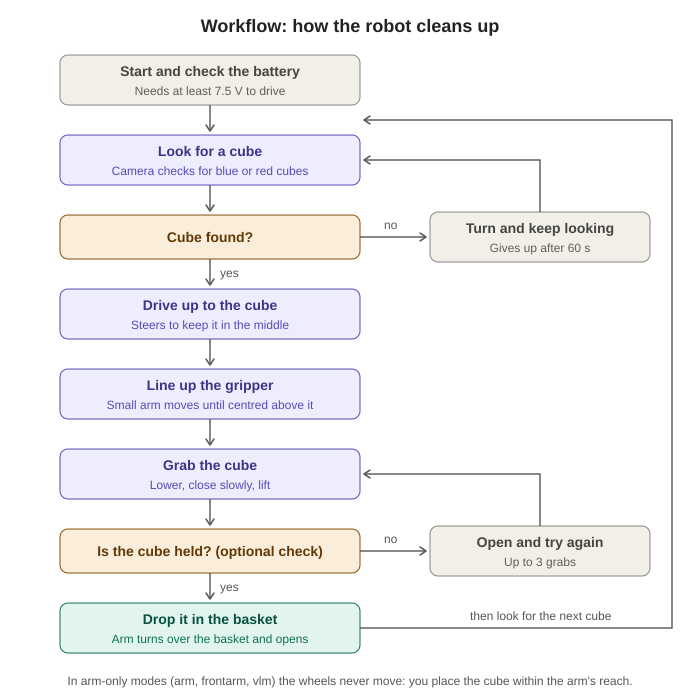

# How it works

This page explains what `robot/fetch_blue.py` does, in the order the robot does it.

## 1. Start

The program connects to ROS, loads the taught arm poses from `~/cleanup_poses.json`, and loads the calibrated grab point if there is one. In driving modes it reads the battery several times and takes the middle value (single readings can be off by a volt). Below **7.5 V** it refuses to drive.

## 2. See the cube

Every arm-camera picture is processed like this:

1. Blur it slightly and convert it to HSV colour (hue, saturation, brightness), which separates colour from lighting.
2. Keep only pixels inside the blue range (and the two red ranges, since red wraps round the hue circle).
3. Clean up the mask: remove specks, join pieces split by shiny highlights.
4. Find the patches and check their shape: solid (≥ 75 % of its outline), fills its box (≥ 45 %), not long and thin (aspect ≤ 2.5), big enough (≥ 150 pixels).

There are two colour tests. The **strict** test (clearly blue, bright) is used to *find* a cube. The **loose** test (also shaded faces and highlights) is used to *keep following* a cube already found.

A tracker follows one cube from picture to picture. It only accepts patches near the last position, smooths the movement, and keeps going through up to 8 missed pictures (about half a second) before it decides the cube is lost. A cube only counts as found after 3 fresh sightings.

The front camera does the same kind of colour search on its own K210 chip (in LAB colour) and sends the result to the robot.

## 3. Drive to it (driving modes only)

- **Search:** turn slowly on the spot until the cube is seen (gives up after 60 s).
- **Approach:** turn to keep the cube in the middle of the picture, drive forward (35 mm/s far away, 22 mm/s close), and stop when the cube is low in the picture, which means it is close.
- If turning makes the error bigger, the program reverses the turn direction by itself.
- Wheel speeds ramp up and down gently. Sudden starts drew so much current that the Pi restarted.

In `front` mode the front camera does the finding and driving. In arm-only modes (`arm`, `frontarm`, `vlm`) the wheels never move and you place the cube within reach (about 12–25 cm in front).

## 4. Line up the gripper

This is a feedback loop:

1. The arm hovers 3 cm above the floor with the camera looking down.
2. The program measures how far the cube is from the grab point in the picture (in pixels).
3. It turns the base and changes the reach by a small step in the right direction.
4. **Inverse kinematics** (Hiwonder's `ArmIK`) turns "reach X metres at height Z" into angles for the shoulder, elbow and wrist servos.
5. Repeat until the cube stays within 20 pixels of the grab point for 10 pictures in a row.

Small errors (under 10 pixels) are ignored so the arm does not chase picture noise. If the cube is out of the arm's reach (12–25 cm), the robot creeps forward or backs up a little (in arm-only modes it asks you to move the cube).

Then the wrist turns to match the cube's angle, and a final fine centring (within 8 pixels) is done.

## 5. Grab

1. Open the gripper and lower about 11 cm from the hover height to the grab height.
2. Close the fingers in one slow movement (`GRIP_SPEED = 900` ms), so the cube is pushed less.
3. Lift straight up 4 cm before swinging away, so the fingers do not knock the cube.

If the gripper always lands a bit short, past, or to one side of the cube, correct it with `REACH_TRIM` (metres) and `BASE_TRIM` (servo units, about 4 units per degree).

## 6. Check the grip (optional)

With `HOLD_CHECK = True`, the arm goes back to the hover height and looks down. If the cube is gone from the floor, or looks at least 1.8 times bigger (because it is right in front of the camera), it is held. If not, the robot opens and tries again, up to 3 times. This check is **off by default** because it was unreliable.

## 7. Drop it in the basket

The arm turns first while still raised, then moves slowly into the taught **DROP** pose over the basket, opens, and returns. Then the robot looks for the next cube. It stops when no cube is left, or after 8 failed attempts in a row.

## Safety

- A background thread watches the battery. Driving is refused below 7.5 V, and the wheels pause if the voltage dips under 7.0 V while driving.
- The arm camera is paused while driving to save processor time and power.
- `SLOW = 2` runs every arm move at half speed.
- On exit (Ctrl+C or `stop_robot.sh`) the wheels get a zero speed.

## Laptop vision with YOLO-World (`vlm` mode)

### Why YOLO-World

Colour detection has two weaknesses: the colour ranges must be tuned by hand and break when the light changes, and anything of the same colour can fool it (dark-blue jeans and a jacket did). **YOLO-World** is an *open-vocabulary* object detector: you give it a text description, such as `"blue square"`, and it draws a box round that object. It is not limited to a fixed list of trained classes, so the target can be changed just by changing the words.

### Settings used

| Setting | Value | Why |
|---|---|---|
| Model | YOLO-World v2 **medium** (`yolov8m-worldv2.pt`) | The small model barely saw the cube |
| Prompt | `"blue square"` | From above, the cube looks like a flat square; `"blue cube"` was not found |
| Picture size | 480 px | Faster than 640 and still accurate |
| Confidence | 0.15 (0.08 also worked) | The cube scored about 0.2–0.45 |
| Speed | about 4 pictures per second on the laptop processor | Result reaches the robot 0.5–0.7 s after the picture |

Results: the cube was found in 315 of 315 pictures, with no false detections in 1000 pictures that included a person and dark-blue clothing.

### How the robot uses it

Because the laptop result is half a second old, the robot does not steer continuously from it. It moves one step, waits until a laptop result arrives for a picture taken *after* the arm stopped, then moves again. If the error grew, it reverses that direction. In a simulation this settled over the cube in 5–7 steps. If no laptop result arrives for a few seconds, the arm holds still.

Details and test results: [vlm-plan.md](vlm-plan.md).

## Modes of `fetch_blue.py`

| Mode | Wheels | What it does |
|---|---|---|
| `look` | No | Detection test only; nothing moves |
| `arm` | No | Arm camera finds the cube in front, arm grabs it |
| *(none)* / `full` | Yes | Search, drive, grab with the arm camera (floor only) |
| `frontlook` | No | Front camera detection test |
| `frontarm` | No | Front camera finds the cube, arm grabs it |
| `front` | Yes | Front camera finds and drives, arm grabs (default of `run_robot.sh`) |
| `vlm` | No | Laptop YOLO-World finds the object, arm grabs it |
| `calibgrab` | No | Measures the grab point once and saves it |
